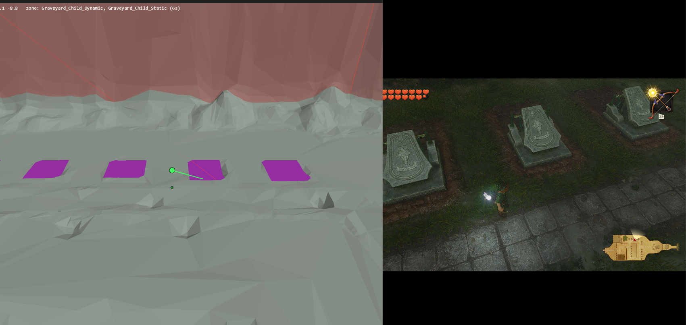
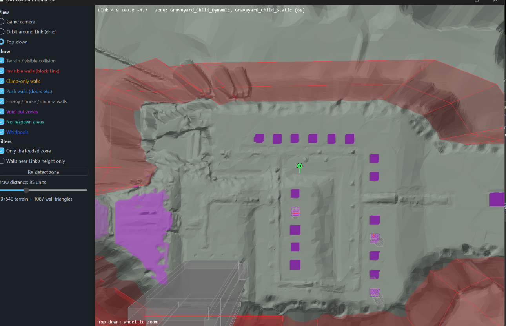

# OoT (Switch 2) Link tools + collision viewer





## Requirements
- Windows, Cheat Engine 7.5+, Python 3.10+ (python.org, tick "Add to PATH").
- Optional: the game's romfs dumped from your emulator (right-click game > Dump RomFS).
  Only needed to draw terrain in the viewer. Walls and void zones work without it.

## Cheat Engine
1. Start the game in the emulator (lichii, eden, ...).
2. Open Cheat Engine, attach to the emulator process.
3. Open oot_link_tools.CT and tick "Link tools".
   It finds Link, health and camera, and opens the "cepipe" server for the viewer.
4. Optional: tick "Moonjump" (Space up, Ctrl down) or "Speed multiplier".
   Edit those scripts (double-click) to change keys or values.

If the viewer says "cepipe not found", open Cheat Engine's Lua engine
(Memory View > Tools > Lua Engine), paste this and press Execute:

```lua
openLuaServer("cepipe")
```

## Viewer
1. Keep Cheat Engine running with "Link tools" ticked.
2. Double-click "Run viewer.bat". The first run installs the Python packages.
3. For terrain, click "Set romfs folder (for terrain)" and pick the dumped romfs folder.
4. Views: Game camera, Orbit (drag to rotate, wheel to zoom), Top-down (wheel to zoom).
   Use the checkboxes to choose what is drawn: terrain, invisible walls,
   void-out zones, no-respawn areas, and so on.

| Colour | Meaning |
|---|---|
| Grey | Terrain / visible collision |
| Red | Invisible walls that block Link |
| Orange | Climb-only walls |
| Blue | Push walls (doors etc.) |
| Purple | Void-out / fall-down zones |
| Teal | No-respawn areas |

After a game update, delete viewer\geom.json; the viewer rebuilds it from the romfs.
